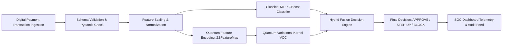

# DIGIRAKSHA (디지락샤 / डिजीरक्षा)
### Quantum-Enhanced Digital Payment Fraud Detection Framework

[](https://opensource.org/licenses/MIT)
[](https://fastapi.tiangolo.com)
[](https://react.dev)
[](https://xgboost.readthedocs.io)
[](https://qiskit.org)

DIGIRAKSHA is a next-generation cybersecurity framework designed to safeguard digital payment ecosystems (including UPI, IMPS, Card Networks, and Cross-Border Corridors) from high-frequency, non-linear fraud signatures through a hybrid classical-quantum detection architecture.

---

## 🌟 Key Highlights

- **Hybrid Inference Pipeline:** Combines classical gradient-boosted decision trees (**XGBoost**) with simulated 4-qubit **ZZ-Feature Map** variational quantum kernels.
- **Mathematically Verified Benchmark:** Initialized with exact baseline metrics:
  $$\text{Fraud Detection Rate} = \left(\frac{\text{Flagged Fraud Transactions}}{\text{Total Analyzed Transactions}}\right) \times 100 = \left(\frac{172}{100,000}\right) \times 100 = 0.172\%$$
- **Real-Time SOC Dashboard:** Complete Security Operations Center view with time-series charts, channel breakdowns, donut risk distributions, and live activity streams.
- **Interactive Transaction Analyzer:** Submit and test custom transaction payloads or test quick-fill presets with sub-20ms processing latency and explainable risk factor attributions.
- **Batch Transaction Simulator:** Manually inject synthetic transaction batches (10, 25, 50) and dynamically recalculate all SOC metrics and charts.
- **Quantum Pipeline Visualizer:** Interactive 8-stage node graph tracking data from ingestion to statevector quantum Hilbert space projection and hybrid fusion.
- **Dual Mode Design System:** Seamless Dark & Light themes with persistent preferences and Uiverse.io & React Bits inspired motion components.

---

## 🏗️ System Architecture



### Hybrid Score Fusion Formulation
$$\text{Risk Score} = 100 \times \left(0.70 \cdot P_{\text{XGBoost}}(x) + 0.30 \cdot \mathcal{Q}_{\text{Anomaly}}(x)\right)$$

Where $\mathcal{Q}_{\text{Anomaly}}(x) = 1 - |\langle \Phi(x) | \Phi(x_{\text{fraud\_cluster}}) \rangle|^2$ represents the quantum kernel distance in Hilbert state space.

---

## 🚀 Quickstart & Local Setup

### Prerequisites
- **Node.js**: v18.0.0 or higher
- **Python**: v3.10, v3.11, v3.12, v3.13, or v3.14

---

### 1. Backend Setup (FastAPI)

```bash
# Navigate to backend directory
cd backend

# Install dependencies
pip install -r requirements.txt

# Run backend test suite
python -m pytest tests/test_api.py

# Start FastAPI development server
uvicorn app.main:app --host 127.0.0.1 --port 8000 --reload
```

Backend API Swagger Documentation will be accessible at: `http://127.0.0.1:8000/docs`

---

### 2. Frontend Setup (React + Vite)

```bash
# In a new terminal, navigate to frontend directory
cd frontend

# Install dependencies
npm install

# Start Vite local development server
npm run dev
```

Open your browser at: `http://localhost:5173`

---

## 📡 REST API Contracts

| Method | Endpoint | Description |
|---|---|---|
| `GET` | `/api/health` | Service health status and mode verification |
| `GET` | `/api/dashboard/summary` | Real-time recalculated metrics, charts series, and initial 0.172% rate |
| `GET` | `/api/transactions` | Query and filter transaction records with pagination |
| `GET` | `/api/transactions/{id}` | Inspect specific transaction telemetry |
| `POST` | `/api/transactions/analyze` | Hybrid XGBoost + Quantum kernel evaluation of transaction payload |
| `POST` | `/api/demo/simulate` | Injects controlled synthetic batches (recalculates all metrics) |
| `POST` | `/api/demo/reset` | Resets dataset to exact initial 0.172% baseline rate |
| `GET` | `/api/pipeline/status` | Real-time status and latency of all 8 pipeline stages |
| `GET` | `/api/ml/metrics` | Evaluation metrics (ROC-AUC, Precision, Recall, Confusion Matrix) |

---

## 🔬 Scientific & Academic Notice

In compliance with academic research standards:
- The **Classical Machine Learning stages** (XGBoost, Scikit-Learn preprocessing, Pydantic validation) are fully functional and production-grade.
- The **Quantum Stage** is implemented as a mathematically formulated **Statevector Quantum Simulator (4-Qubit ZZFeatureMap)** pending physical QPU dispatch.
- Simulated metrics are clearly labeled and do not claim live banking infrastructure integration.

---

## 📄 License
Released under the MIT Open Source License.
